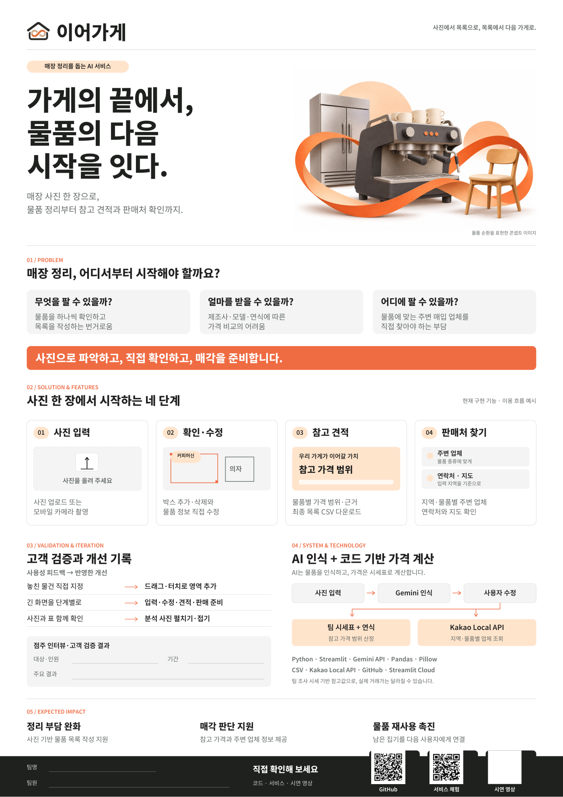

# 이어가게 A0 포스터

## 피드백 반영본 v2

- [수정본 PDF](v2/ieogage_A0_v2_print.pdf)
- [수정본 미리보기](v2/ieogage_A0_v2_preview.png)
- [수정본 PowerPoint](v2/ieogage_A0_v2_editable.pptx)
- [수정본 전체 파일·글꼴 ZIP](v2/ieogage_A0_v2_complete.zip)

설문 결과와 반영 기능, 실제 UI의 시연용 입력 예시, 숫자로 표시한 견적 범위를 추가했습니다. 인터뷰 기입란을 삭제하고 제목·이미지를 축소해 본문을 확대했습니다. [수정 내용](v2/README.md)

## 최초 제작본

841 × 1189 mm, 세로형 1페이지입니다.

- [인쇄용 PDF](ieogage_A0_print.pdf)
- [포스터 미리보기](ieogage_A0_preview.png)
- [편집용 PowerPoint](ieogage_A0_editable.pptx)
- [전체 파일·글꼴·편집 안내 ZIP](ieogage_A0_complete.zip)

인터뷰 대상·인원·기간·주요 결과, 팀명·팀원, 시연 영상 QR은 직접 채울 수 있도록 비워 두었습니다. GitHub와 서비스 체험 QR은 실제 주소로 연결됩니다.

PowerPoint 편집 전 ZIP에 포함된 글꼴 3종을 설치하면 서체를 유지할 수 있습니다. PDF에는 한글 글꼴이 포함되어 있습니다.

상단 이미지는 물품 순환을 표현한 콘셉트 일러스트입니다. 고객 검증 수치나 성과 수치는 임의로 작성하지 않았습니다.

