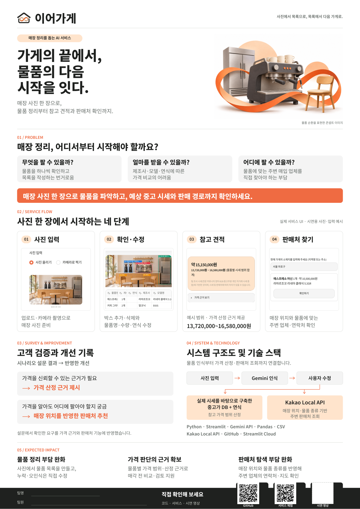

# 이어가게 A0 포스터 — 피드백 반영본

A0 세로형 841 × 1189 mm, 1페이지입니다.

- [인쇄용 PDF](ieogage_A0_v2_print.pdf)
- [미리보기](ieogage_A0_v2_preview.png)
- [편집용 PowerPoint](ieogage_A0_v2_editable.pptx)
- [전체 파일·글꼴·편집 안내 ZIP](ieogage_A0_v2_complete.zip)

## 반영 사항

- 기존 제목·일러스트를 축소하고 본문과 기능 화면 영역을 확대.
- 해결 문구를 ‘매장 사진 한 장으로 물품을 파악하고, 예상 중고 시세와 판매 경로까지 확인하세요.’로 변경.
- 핵심 기능 영역 이름을 Service Flow로 변경하고 네 단계에 실제 서비스 UI 캡처 추가.
- DB에서 계산한 예시 금액 표시: 총 15,150,000원, 범위 13,720,000~16,580,000원.
- 인터뷰 기입란 삭제. 사용자가 전달한 시나리오 설문 결과를 ‘가격 신뢰성 → 가격 산정 근거 제시’, ‘판매 경로 탐색 → 매장 위치를 반영한 판매처 추천’으로 정리.
- ‘시스템 구조도 및 기술 스택’, ‘실제 시세를 바탕으로 구축한 중고가 DB + 연식’으로 요청 문구 반영. 표시 스택에서 Pillow 제거.
- 기대 효과를 현재 기능과 연결: 물품 정리 부담 완화, 가격 판단의 근거 확보, 판매처 탐색 부담 완화.

## 예시 및 편집 안내

기능 화면은 실제 서비스 UI를 로컬에서 렌더링한 캡처입니다. 시연 사진은 가상의 카페 이미지이며, 물품 박스·브랜드·모델은 설명용으로 설정했습니다. 실제 AI 분석 성능이나 사진 속 제품의 브랜드·모델을 확정하는 자료가 아닙니다. 예시 가격은 기존 가격 DB·코드로 계산했습니다. 화면 위에 ‘실제 서비스 UI · 시연용 사진·입력 예시’를 표시했습니다.

설문 응답자 수·만족도·절감률 등 미제공 수치는 작성하지 않았습니다. 팀명·팀원·시연 영상 QR은 빈칸입니다. GitHub와 서비스 QR은 실제 주소입니다.

PDF에는 한글 글꼴이 포함되어 있습니다. PowerPoint 편집 전 ZIP의 글꼴 3종을 설치하면 서체가 유지됩니다.

