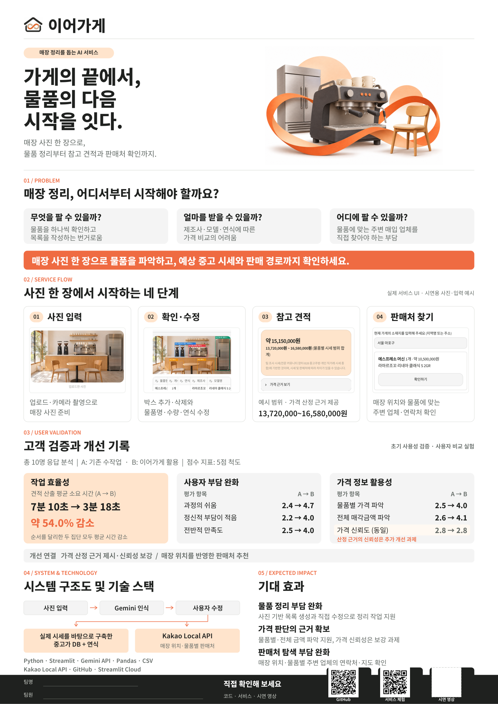

# 이어가게 A0 포스터 v3 — 사용자 비교 실험 결과 반영

A0 세로형 841 × 1189 mm, 1페이지입니다.

- [인쇄용 PDF](ieogage_A0_v3_print.pdf)
- [미리보기](ieogage_A0_v3_preview.png)
- [편집용 PowerPoint](ieogage_A0_v3_editable.pptx)
- [전체 파일·글꼴·편집 안내 ZIP](ieogage_A0_v3_complete.zip)

## 사용자 제공 결과

총 10명 응답 분석, A는 기존 수작업 방식, B는 이어가게 활용 방식입니다. 점수 지표는 5점 척도입니다.

| 지표 | A | B |
|---|---:|---:|
| 견적 산출 평균 소요 시간 | 7분 10초 | 3분 18초 |
| 과정의 쉬움 | 2.4 | 4.7 |
| 정신적 부담이 적음 | 2.2 | 4.0 |
| 전반적 만족도 | 2.5 | 4.0 |
| 물품별 가격 파악 용이성 | 2.5 | 4.0 |
| 전체 매각금액 파악 용이성 | 2.6 | 4.1 |
| 가격 신뢰도 | 2.8 | 2.8 |

평균 시간 감소율은 약 54.0%입니다. 사용자의 설명에 따라 실험 순서를 달리한 두 집단 모두에서 평균 시간 감소가 관찰되었음을 표시했습니다. 집단별 인원·시간·통계적 유의성 등 제공되지 않은 결과는 추가하지 않았습니다.

가격 정보의 파악 용이성 개선과 가격 신뢰도를 구분해 제시했습니다. 가격 신뢰도는 동일하며 산정 근거의 신뢰성 확보는 추가 개선 과제입니다. 초기 사용성 검증 결과로 표현했습니다.

## 디자인 수정

- 고객 검증 영역을 가로로 넓혀 세 가지 평가 측면을 한눈에 비교하도록 배치했습니다.
- 상단 오른쪽 문구와 그림 아래 콘셉트 이미지 캡션을 삭제했습니다.
- 기존 그림을 왼쪽으로 옮겨 제목과 그림 사이의 여백을 줄였습니다.
- 시스템 구조도·기능·예시 견적·QR을 유지했습니다. 팀명·팀원·시연 영상 QR은 빈칸입니다.

## 편집과 예시 안내

PDF에는 한글 글꼴이 포함되어 있습니다. PowerPoint 편집 전 ZIP의 글꼴 3종을 설치하면 서체가 유지됩니다.

상단은 기존 AI 생성 콘셉트 일러스트입니다. 기능 화면은 실제 서비스 UI를 로컬에서 렌더링한 시연 예시이며 사진·박스·브랜드·모델 정보는 설명용으로 설정했습니다. 실제 AI 분석 성능을 측정한 화면은 아닙니다. 예시 견적은 기존 DB·코드로 계산한 참고값입니다.

